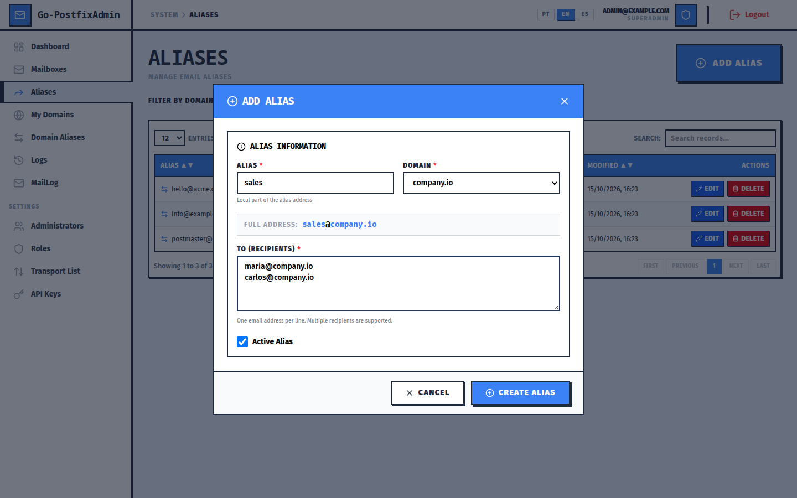
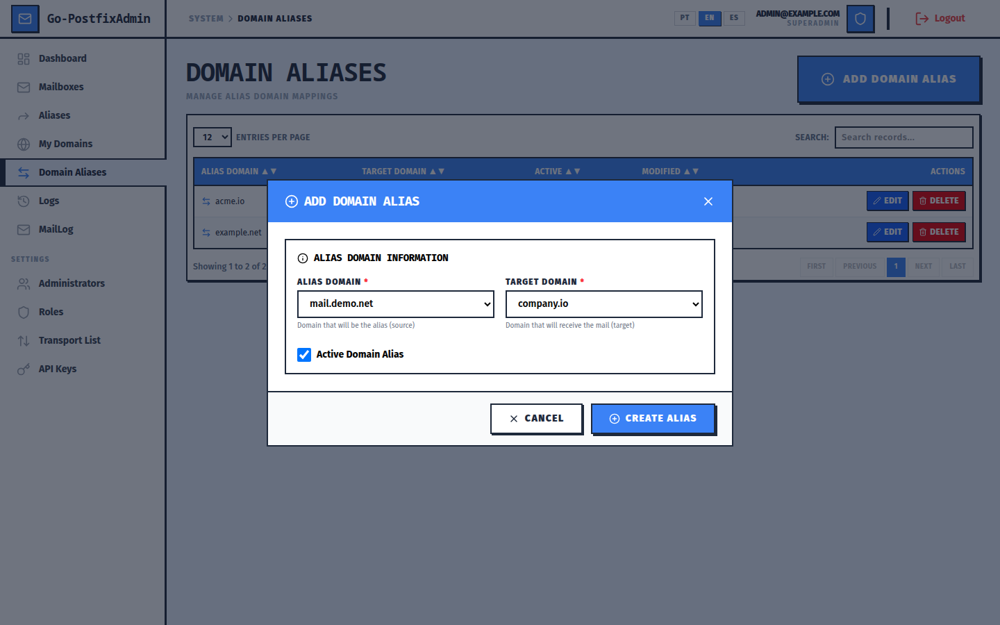
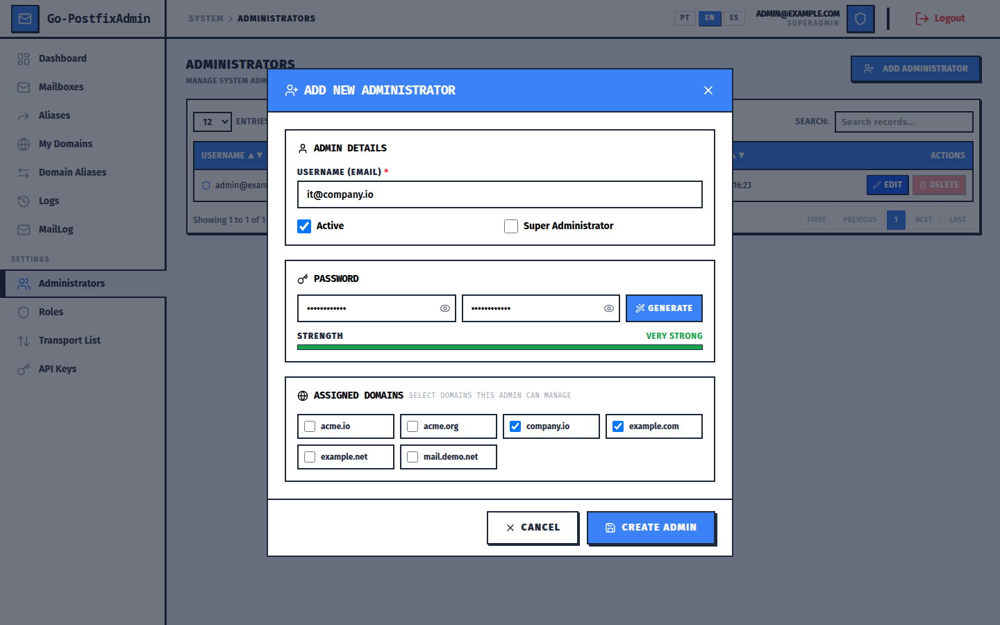
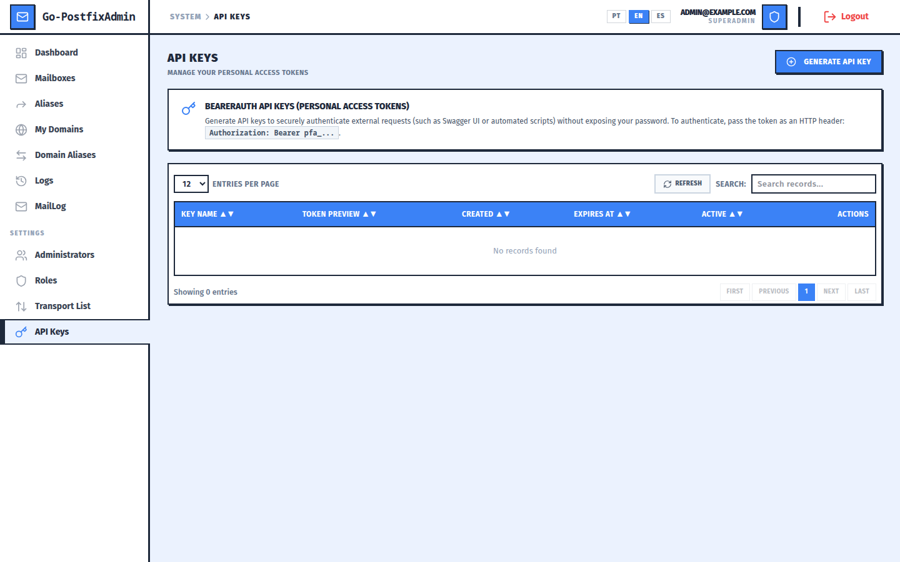
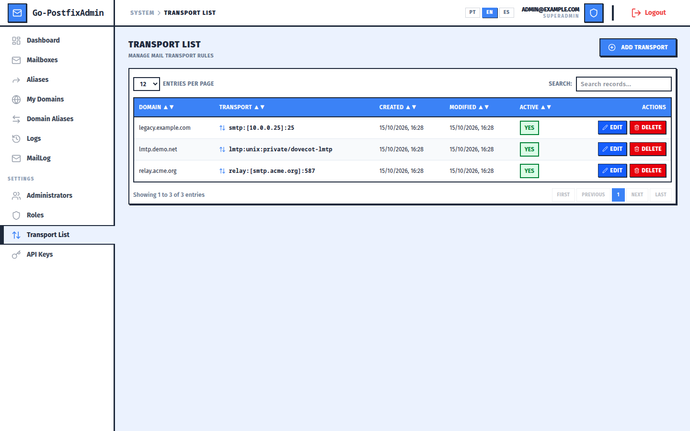

# Go-PostfixAdmin Screenshots

All screenshots were taken from the Go-PostfixAdmin Vue 3 SPA using demo data.

## Administrator

| Login | Dashboard |
|-------|-----------|
|  |  |

| Domains | Add domain |
|---------|------------|
|  |  |

| Email accounts | Add email account |
|----------------|-------------------|
|  |  |

| Aliases | Add alias |
|---------|-----------|
|  |  |

| Domain aliases | Add domain alias |
|----------------|------------------|
|  |  |

| Administrators | Add administrator |
|----------------|-------------------|
|  |  |

| RBAC roles | API keys |
|------------|----------|
|  |  |

| Transports | Audit log |
|------------|-----------|
|  |  |

| Mail delivery log | Swagger UI |
|-------------------|------------|
|  |  |

## User Portal

| Login | Forwarding & password |
|-------|-----------------------|
|  |  |

| Vacation / auto-reply |
|-----------------------|
|  |
