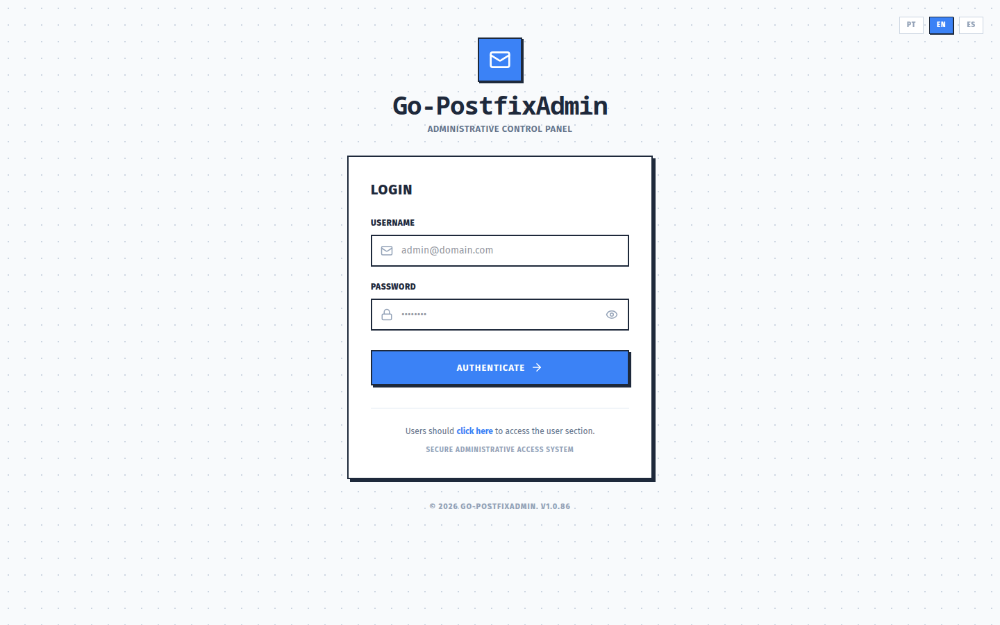
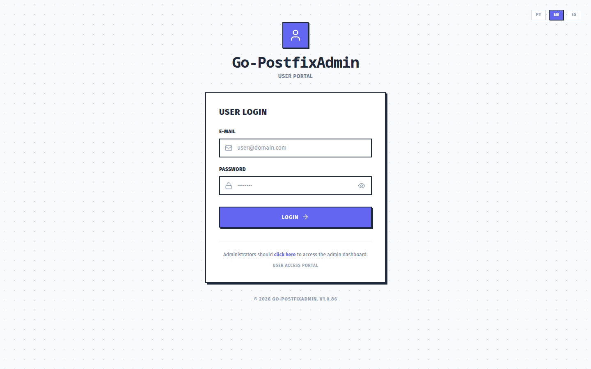

# Go-PostfixAdmin Screenshots

All screenshots below were taken from the Go-PostfixAdmin Vue 3 SPA using demo data.

## Administrator

| Login | Dashboard |
|-------|-----------|
|  |  |

| Domains | Mailboxes |
|---------|-----------|
|  |  |

| Aliases | Administrators |
|---------|----------------|
|  |  |

## User Portal

| Login | Dashboard (forwarding & password) |
|-------|-----------------------------------|
|  |  |

| Vacation / Auto-reply |
|-----------------------|
|  |
