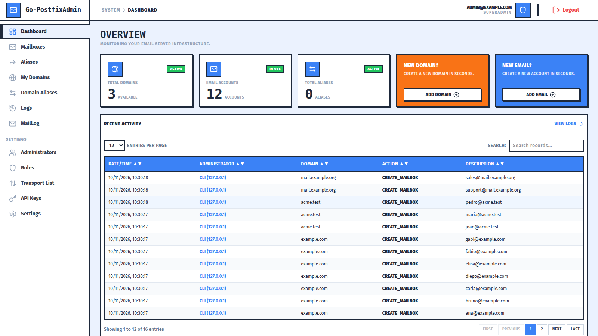
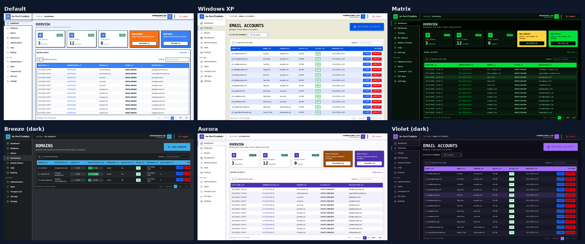
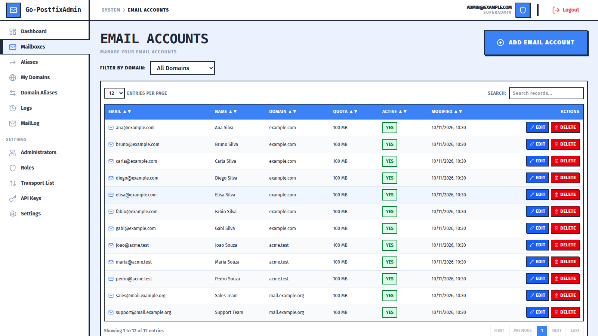
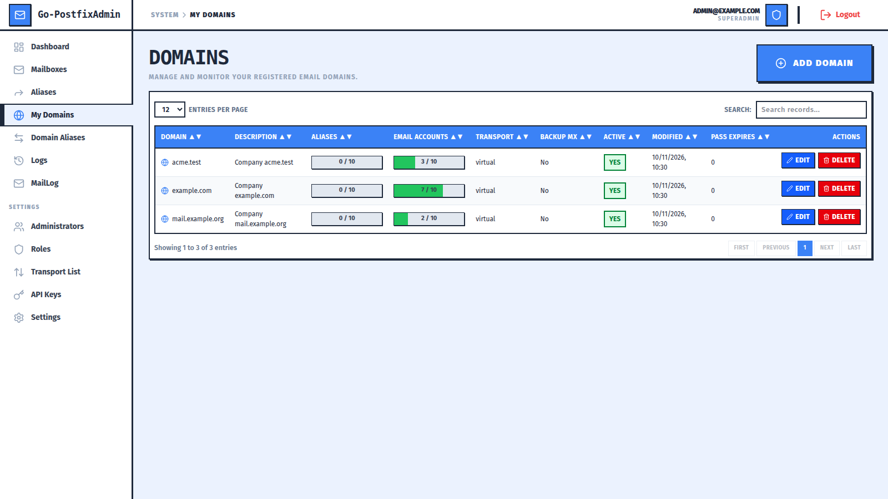
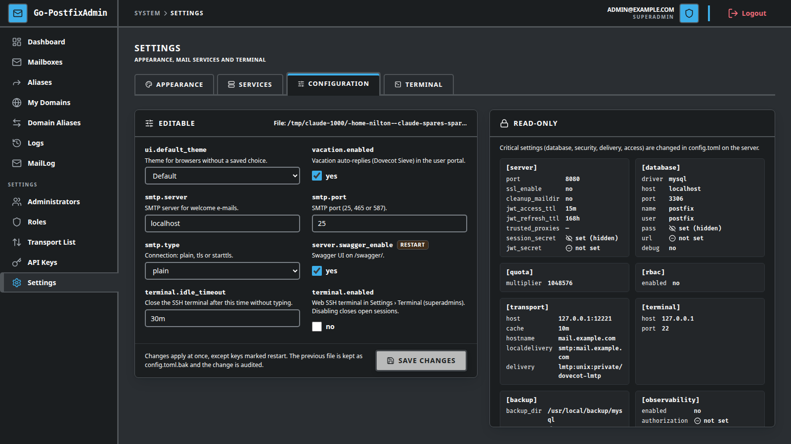
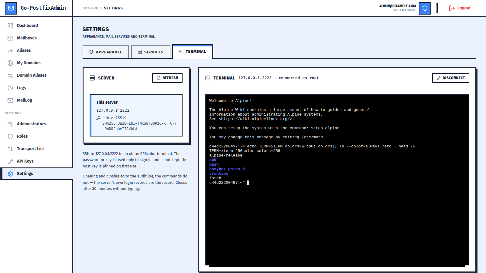
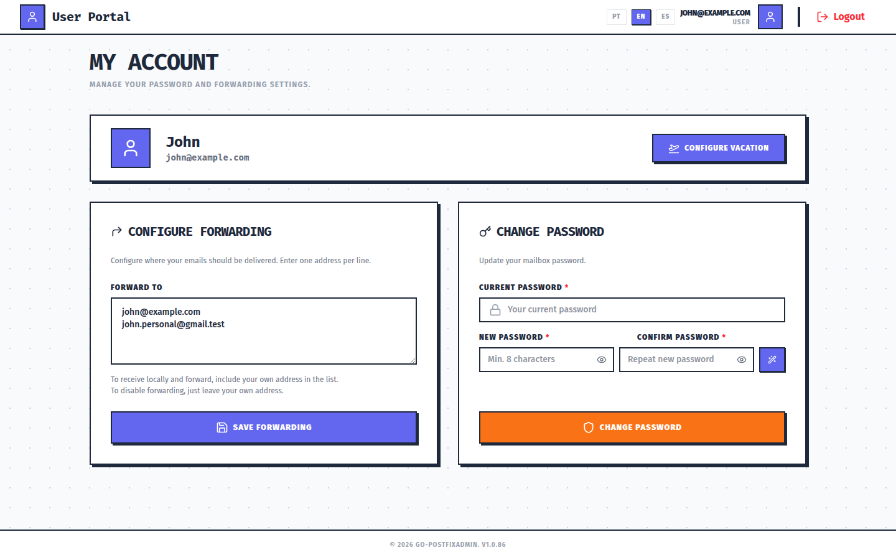
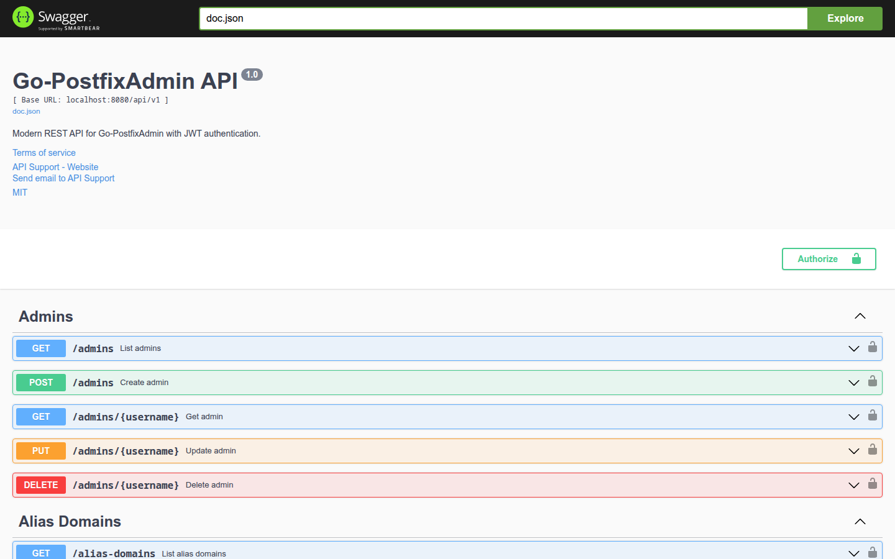

<h1 align="center">Go-PostfixAdmin</h1>

<p align="center">
  <b>The mail server admin panel you deploy in one minute.</b><br>
  Domains, mailboxes, aliases, admins and a self-service portal for Postfix + Dovecot —<br>
  one Go binary, a REST API, 20 themes, no PHP.
</p>

<p align="center">
  <a href="https://github.com/jniltinho/go-postfixadmin/releases/latest"></a>
  <a href="https://github.com/jniltinho/go-postfixadmin/pkgs/container/go-postfixadmin"></a>
  <a href="https://github.com/jniltinho/go-postfixadmin/actions/workflows/release.yml"></a>
  <a href="https://github.com/jniltinho/go-postfixadmin/releases"></a>
  <a href="https://go.dev/"></a>
  <a href="LICENSE"></a>
  <a href="https://github.com/jniltinho/go-postfixadmin/stargazers"></a>
</p>

<p align="center">
  <a href="#-try-it-in-one-minute">Try it</a> ·
  <a href="#-screenshots">Screenshots</a> ·
  <a href="#-what-you-get">Features</a> ·
  <a href="DOCUMENTS/README.md">Documentation</a> ·
  <a href="https://github.com/jniltinho/go-postfixadmin/releases/latest">Download</a>
</p>

<p align="center">
  
</p>

## ✨ Why admins pick it

- 📦 **One file, nothing else** — UI, API docs and translations live inside a single static binary. No PHP-FPM, no web server, no Node in production. Docker image, `.deb` and `.rpm` too.
- ⚡ **Running in a minute** — `docker compose up` gives you the panel and a database with the first admin ready.
- 🔌 **API-first** — every click is a documented REST call (`/api/v1`, Swagger UI) with JWT and API keys: script provisioning from day one.
- 👥 **Built for teams** — superadmins, domain admins and fine-grained RBAC roles decide who sees and changes what.
- 🙋 **Users help themselves** — mailbox owners change their password, set forwarding and vacation replies in their own portal.
- 🎨 **Your look, any screen** — 20 themes (yes, **Windows XP**), PT/EN/ES, and a layout that scales from a laptop to 4K.
- 🛠️ **Ops built in** — see Postfix/Dovecot/Rspamd status, tweak settings and open an SSH terminal from the browser.
- 🔁 **Drop-in for PostfixAdmin data** — same tables and `$2y$` bcrypt hashes, on MariaDB/MySQL or PostgreSQL.

## 🚀 Try it in one minute

```bash
git clone https://github.com/jniltinho/go-postfixadmin.git && cd go-postfixadmin
docker compose up -d
```

Open **http://localhost:8080** and sign in as `admin@example.com` / `adminpassword` (change it in
[docker-compose.yml](docker-compose.yml)).

**Already have a database?** Use the image from GitHub Packages (`linux/amd64` and `linux/arm64`):

```bash
docker run -d -p 8080:8080 \
  -e DB_URL="postfix:pass@tcp(your-db:3306)/postfix?charset=utf8mb4&parseTime=True" \
  ghcr.io/jniltinho/go-postfixadmin:latest
```

**Prefer a package?** Grab the binary, `.deb` or `.rpm` from [Releases](https://github.com/jniltinho/go-postfixadmin/releases/latest):

```bash
./postfixadmin --generate-config && ./postfixadmin migrate
./postfixadmin admin --add-superadmin admin@example.com:'S3cure!Pass'
./postfixadmin server
```

Production setup with Postfix, Dovecot and Sieve: **[step-by-step guide](DOCUMENTS/setup/README.md)**.

## 📸 Screenshots

**Pick your style** — 20 themes, switched live in Settings:

<p align="center">
  
</p>

| Email accounts | Domains |
|----------------|---------|
|  |  |

| Settings: configuration | Settings: web SSH terminal |
|-------------------------|----------------------------|
|  |  |

| User self-service portal | REST API (Swagger) |
|--------------------------|--------------------|
|  |  |

More in the **[screenshot gallery](DOCUMENTS/screenshots/README.md)**.

## 🧩 What you get

| | |
|---|---|
| **Mail** | Domains with limits and quotas, mailboxes, aliases, alias domains, backup MX, per-domain transports |
| **Users** | Self-service portal: password, forwarding, vacation auto-reply (Dovecot Sieve) |
| **Access** | Superadmins, domain admins, RBAC roles, API keys with expiry |
| **Security** | Short-lived JWT + httpOnly refresh cookie, login rate limiting, CSRF checks, strong password policy |
| **Settings** | Themes and language, service status, safe `config.toml` editing (secrets never shown), opt-in SSH terminal with pinned host key |
| **Operations** | Audit log, mail delivery log, quota reports, MySQL backups, Postfix `transport_maps` server, OpenTelemetry export |
| **Everywhere** | English, Português, Español · FullHD, QHD and 4K · MariaDB/MySQL and PostgreSQL |

Every feature and API route: [FEATURES.md](FEATURES.md).

## 🐳 Docker images

Every release tag publishes a multi-arch image to GitHub Packages through the
[Docker image workflow](.github/workflows/docker.yml):

```bash
docker pull ghcr.io/jniltinho/go-postfixadmin:latest     # or :1.0, :1.0.89
```

Tags, platforms, environment variables and how to publish: [Documentation › Docker image](DOCUMENTS/README.md#docker-image).

## 📚 Documentation

| | |
|---|---|
| [Documentation guide](DOCUMENTS/README.md) | Install options, Docker image, configuration, Settings, themes, reverse proxy, security, API |
| [Mail server setup](DOCUMENTS/setup/README.md) | Postfix, Dovecot, MariaDB/PostgreSQL, Sieve, rsyslog — end to end |
| [Development](DEVELOPMENT.md) | Build, CLI reference, frontend workflow, tests |
| [Contributing](CONTRIBUTING.md) | Workflow, conventions, adding a theme or a language |

**Built with** Go 1.27 · Echo v5 · GORM · Vue 3 · Vite+ · Tailwind CSS v4 · xterm.js

## ⭐ Support the project

If Go-PostfixAdmin saves you time, **star the repository** — it helps other admins find it. Issues and pull requests
are welcome; start with [CONTRIBUTING.md](CONTRIBUTING.md).

## License

MIT — see [LICENSE](LICENSE). Go-PostfixAdmin is an independent project, inspired by and not affiliated with
[PostfixAdmin](https://github.com/postfixadmin/postfixadmin).
